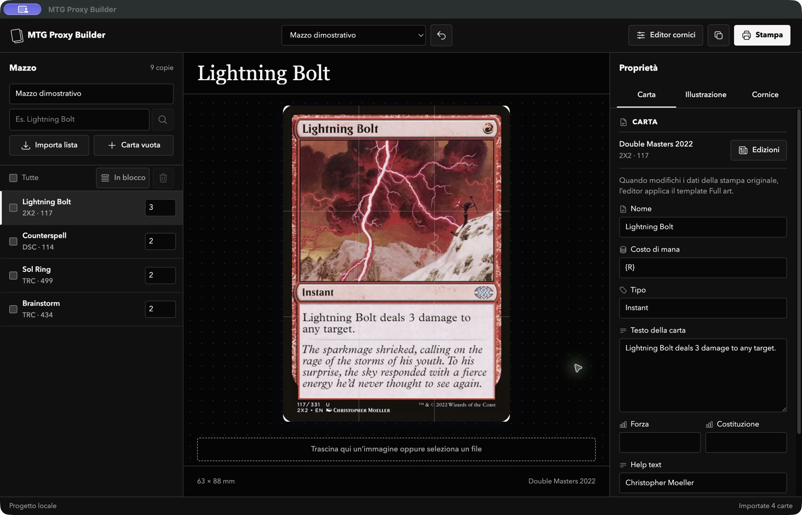
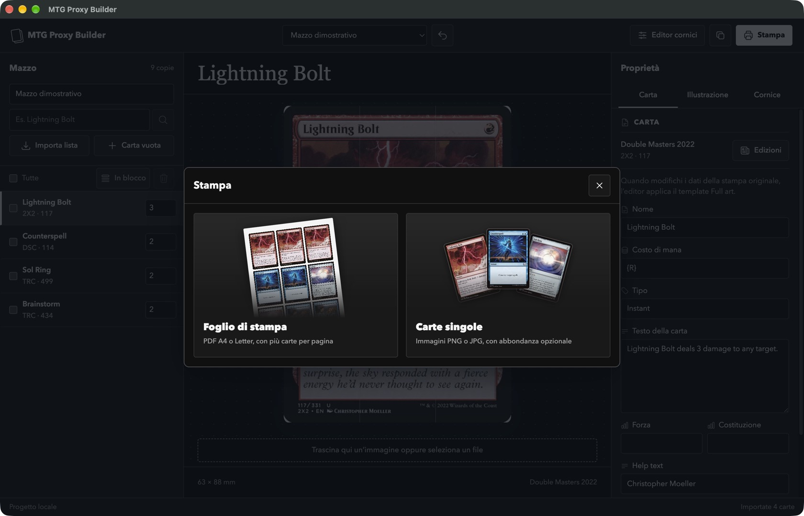

# MTG Proxy Builder

Crea e stampa proxy di Magic: The Gathering su macOS e Windows. Importa una decklist, personalizza le carte e porta il mazzo su carta o esportalo come immagini.

[Scarica l’ultima release](https://github.com/StefanoVe/mtg-proxy-builder/releases/latest) · [Tutte le versioni](https://github.com/StefanoVe/mtg-proxy-builder/releases)



## Download

| Sistema | Installer |
| --- | --- |
| macOS con Apple Silicon (serie M) | `-arm64.dmg` |
| macOS con processore Intel | `-x64.dmg` |
| Windows a 64 bit | `-x64.exe` |

Gli installer delle release automatiche sono distribuiti senza firma di distribuzione o notarizzazione.

## Dalla decklist alla stampa

Scegli **Italiano** o **English** nella barra superiore. Al primo avvio l’app usa la lingua di sistema se supportata, altrimenti l’inglese. La scelta viene ricordata ai successivi avvii.

1. **Importa il mazzo.** Cerca una carta su Scryfall oppure incolla una lista. Puoi indicare quantità, set e numero di collezione, per esempio `2 Lightning Bolt (2X2) 117`. I progetti e le immagini già acquisite sono salvati in locale.
2. **Personalizza le carte.** Seleziona un’edizione, modifica il testo o trascina un PNG, JPEG o WebP sull’anteprima. Regola ritaglio e zoom dalla scheda **Illustrazione**. Il primo edit del testo di una scansione originale attiva il template Full art.
3. **Scegli la cornice.** Sfoglia le edizioni o usa Full art e Illustrazione estesa. Da **Cornice → Personalizza template** puoi spostare e ridimensionare le zone, modificare colori e ombre, importare un overlay PNG e salvare la configurazione come base del progetto.
4. **Applica modifiche in blocco.** Abbina le immagini ai nomi delle carte, per esempio `Lightning Bolt.jpg`, e scegli come gestire duplicati e modifiche esistenti. Puoi applicare preset o set di cornici a tutta la selezione.
5. **Esporta.** Scegli **Foglio di stampa** per un PDF A4 o Letter, oppure **Carte singole** per salvare PNG o JPG in uno ZIP con risoluzione, abbondanza (bleed), retro e copie configurabili.



Per carte da **63 × 88 mm**, stampa il PDF al **100%**. Per le carte a due facce, scegli il ribaltamento sul lato lungo. I layout speciali mantengono la grafica dell’edizione selezionata. Ogni esportazione accetta fino a 1500 copie.

Per una carta con due facce disponibili, usa **Fronte** e **Retro** sotto l’anteprima per modificare separatamente testo, illustrazione e cornice. Le modifiche al testo attivano il template sulla faccia selezionata; il PDF e le immagini esportate usano le stesse impostazioni.

<details>
<summary>Set di cornici e simboli nel testo</summary>

- Da **Set di cornici** importa sei PNG trasparenti allineati, uno per ogni colore e uno incolore. Attiva la miscela per fondere le cornici delle carte multicolore. Con la miscela disattivata, le multicolore usano il PNG incolore, come le carte senza colore.
- Usa la notazione `{T}`, `{Q}`, `{E}`, `{W/U}` o `{U/P}` per inserire i simboli nel testo. L’anteprima e il PDF usano gli stessi SVG.

</details>

## Server MCP

Il server MCP è temporaneamente disattivato a causa di un problema di avvio su Windows. [Segui la riattivazione su GitHub](https://github.com/StefanoVe/mtg-proxy-builder/issues/2).

## Sviluppo

Con Node.js 24:

```sh
npm ci
npm run dev
```

- `npm test` verifica parsing, abbinamenti, immagini e impaginazione.
- `npm run build && npm run test:desktop` prova l’editor Electron con un catalogo di test, esporta un PDF e uno ZIP e riapre il progetto offline.
- `npm run dist:mac` genera i DMG per Apple Silicon e Intel su macOS. `npm run dist:win` genera l’installer NSIS x64 su Windows.

Il workflow [Desktop builds and releases](.github/workflows/desktop.yml) prova i pacchetti per tutte e tre le piattaforme sulle pull request e sui push a `main`. Dopo ogni push riuscito su `main`, pubblica i tre installer in un’unica release con un tag nel formato `v<versione>-build.<numero>`. Puoi anche avviare manualmente la build dalla scheda Actions.

## Crediti

Le immagini di catalogo e i simboli provengono da Scryfall. Magic: The Gathering e i suoi simboli appartengono a Wizards of the Coast. [Catalogo dei simboli](https://api.scryfall.com/symbology)
